<p align="center">
  
</p>

<h1 align="center">Bookstore · Estante de Livros</h1>

<p align="center">
  Catálogo pessoal de livros físicos com controle de empréstimos e uma vitrine pública para amigos pedirem livros emprestados.
</p>

<p align="center">
  
  
  
  
</p>

<p align="center">
  <a href="#sobre">Sobre</a> •
  <a href="#demo">Demo</a> •
  <a href="#como-funciona">Como funciona</a> •
  <a href="#funcionalidades">Funcionalidades</a> •
  <a href="#como-executar">Como executar</a> •
  <a href="#api">API</a> •
  <a href="#tecnologias">Tecnologias</a> •
  <a href="#licenca">Licença</a>
</p>

<p align="center">
  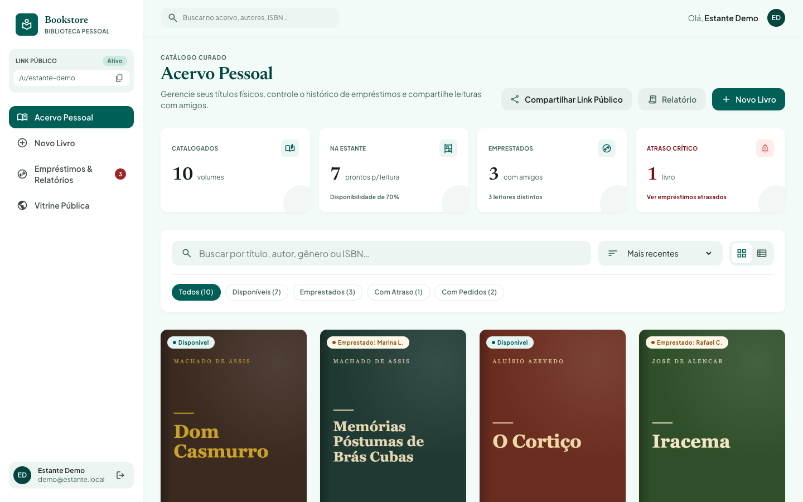
</p>

<h2 id="sobre">Sobre</h2>

O projeto nasceu para organizar os livros que temos em casa e cresceu até virar uma pequena plataforma multiusuário. Cada pessoa cria a própria conta, cadastra o acervo com capa e metadados, registra quem pegou cada livro e até quando, e ganha um link público (`/u/<seu-nome>`) onde amigos navegam pela estante e pedem livros emprestados.

<h2 id="demo">Demo</h2>

Versão online: **[estante-livros.vercel.app](https://estante-livros.vercel.app/)**

Tour completo (login, cadastro de livro, empréstimo, aprovação de pedido e vitrine pública):

<p align="center">
  
</p>

<p align="center"><a href="docs/media/demo.mp4">▶ Assistir em MP4 (1280×800, 80s)</a></p>

> Os dados das telas são de demonstração: obras em domínio público com capas geradas.

<h2 id="como-funciona">Como funciona</h2>

O app tem dois lados: o **painel do dono**, que exige login, e a **vitrine pública**, aberta a qualquer pessoa com o link.

```
Visitante na vitrine ──pede livro──▶ Pedido pendente ──dono aprova──▶ Empréstimo ativo ──dono registra──▶ Devolvido
                                                   └──dono recusa──▶ (removido)
Dono no painel ─────empresta direto────────────────────────────────▶ Empréstimo ativo
```

### 1. Conta e acesso

Crie uma conta com nome, e-mail e senha (mínimo de 6 caracteres) ou entre com Google, se o `GOOGLE_CLIENT_ID` estiver configurado. A sessão usa JWT válido por 7 dias. Na criação, cada usuário recebe um *slug* único, usado no link público.

| Entrar | Criar conta |
| --- | --- |
| 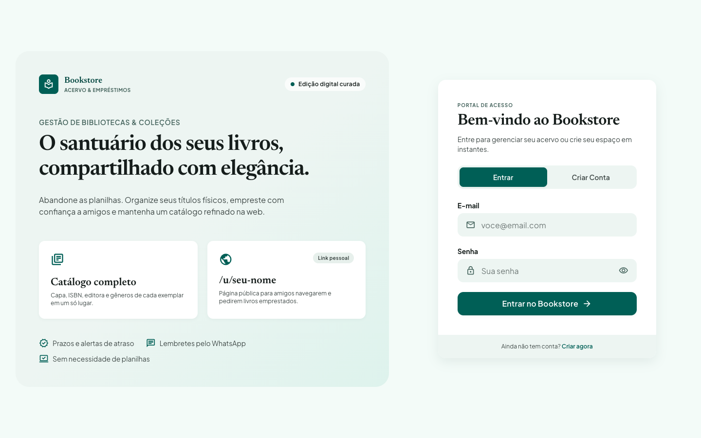 | 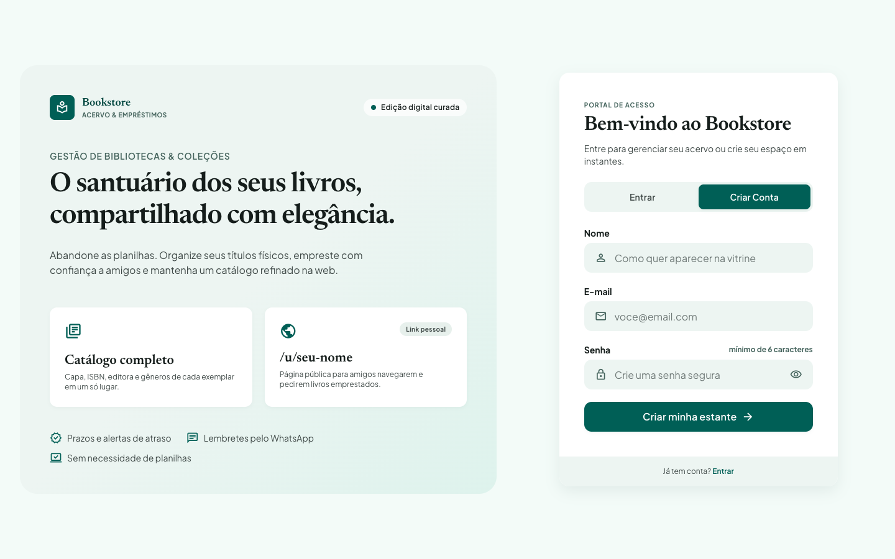 |

### 2. Acervo pessoal

A tela inicial mostra o catálogo com quatro indicadores: livros catalogados, livros na estante, livros emprestados e atrasos. Dá para buscar por título, autor, gênero ou ISBN, filtrar por *Disponíveis*, *Emprestados*, *Com atraso* e *Com pedidos*, ordenar por data, título ou autor e alternar entre grade e lista.

Cada card mostra o status do exemplar (disponível, emprestado com quem, atrasado há quantos dias) e a ação certa para o momento: **Emprestar**, **Registrar devolução** ou **Cobrar**, que abre o WhatsApp com uma mensagem pronta.

| Grade | Lista |
| --- | --- |
| 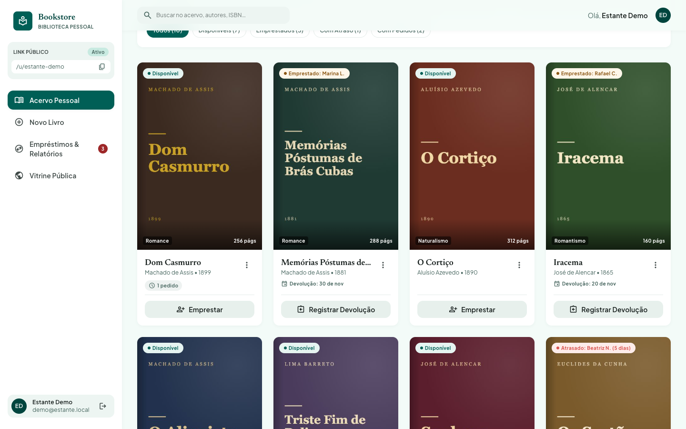 | 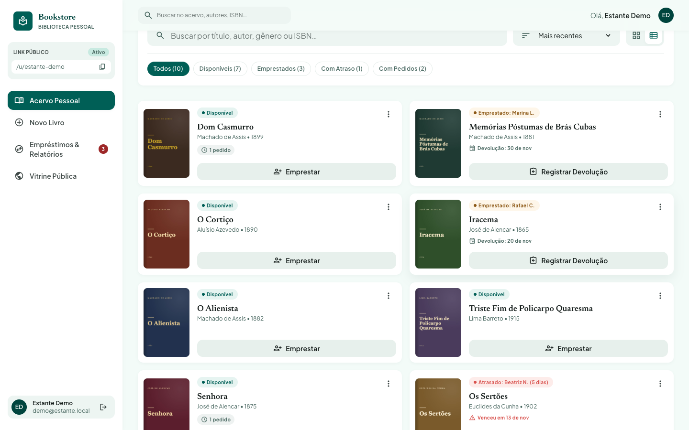 |

| Filtro "Com atraso" | Detalhes da obra |
| --- | --- |
| 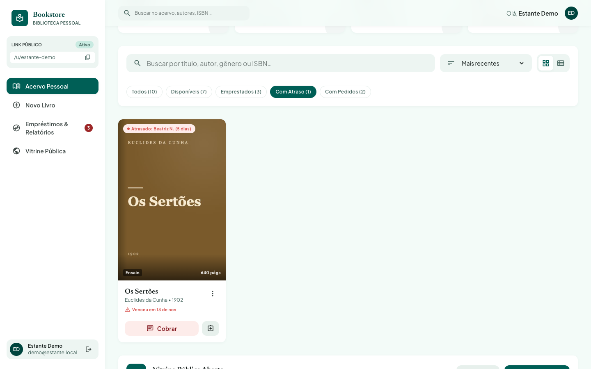 | 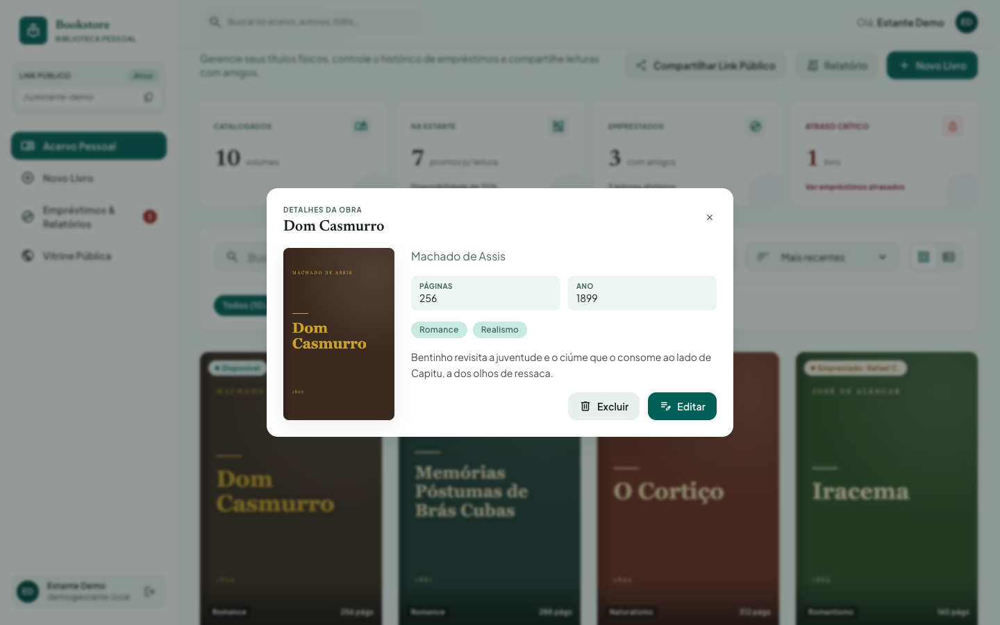 |

### 3. Cadastro de livros

Título e autoria são obrigatórios. Também é possível informar páginas, ano, editora, ISBN (10 ou 13 dígitos), até 10 tags e uma sinopse. A capa pode ser arrastada ou escolhida no computador; o navegador reduz a imagem para 300 px antes do envio. O livro pode ser marcado como indisponível ou ficar fora da vitrine pública (aparece como *Privado* no acervo).

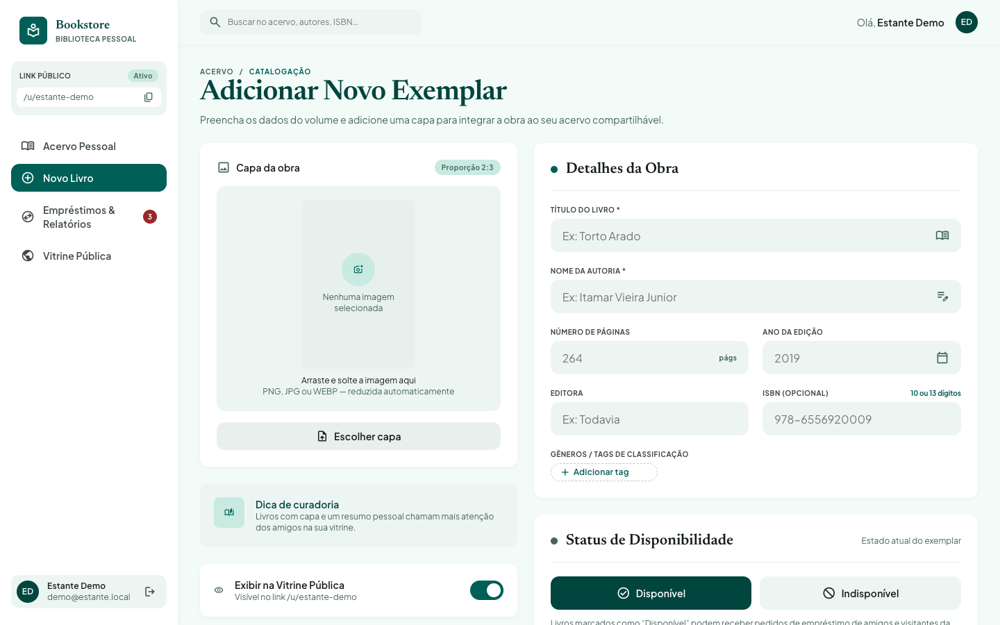

### 4. Empréstimos

Ao emprestar, informe quem levou, o telefone e o prazo. O padrão é de 21 dias. Um livro não pode ter dois empréstimos ativos ao mesmo tempo.

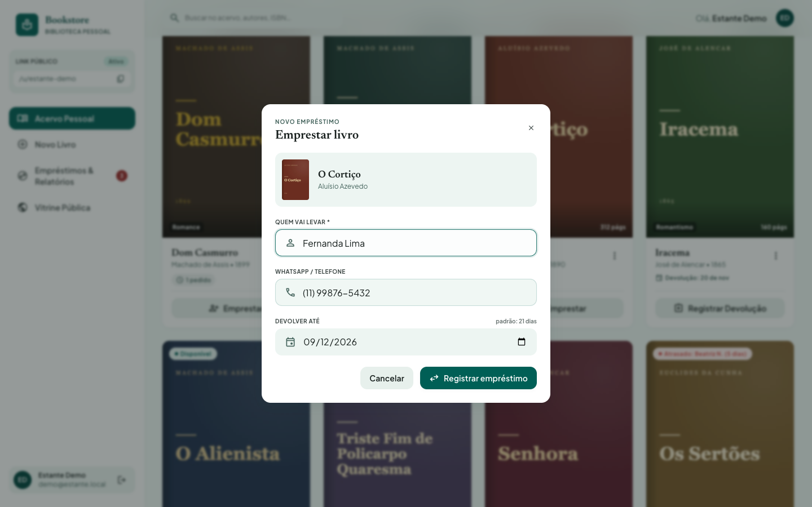

A página **Empréstimos & Relatórios** reúne tudo:

- **Alerta de devolução** para o empréstimo mais atrasado, com atalhos para lembrar pelo WhatsApp ou registrar a devolução.
- **Indicadores**: volumes em circulação, atrasos, eficácia (percentual de devoluções no prazo) e tempo médio de permanência.
- **Abas** *Ativos*, *Pendentes* (pedidos da vitrine, que podem ser aprovados ou recusados) e *Histórico completo*.
- **Relatório consolidado** paginado, com exportação para CSV.

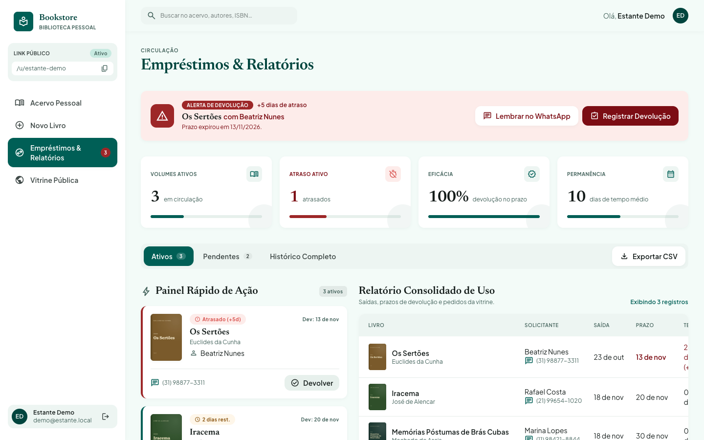

| Pedidos da vitrine | Histórico |
| --- | --- |
| 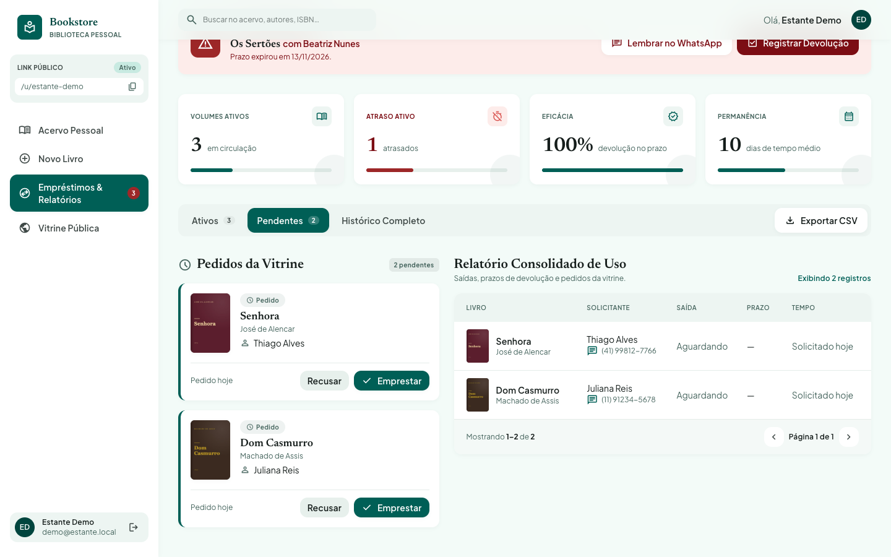 | 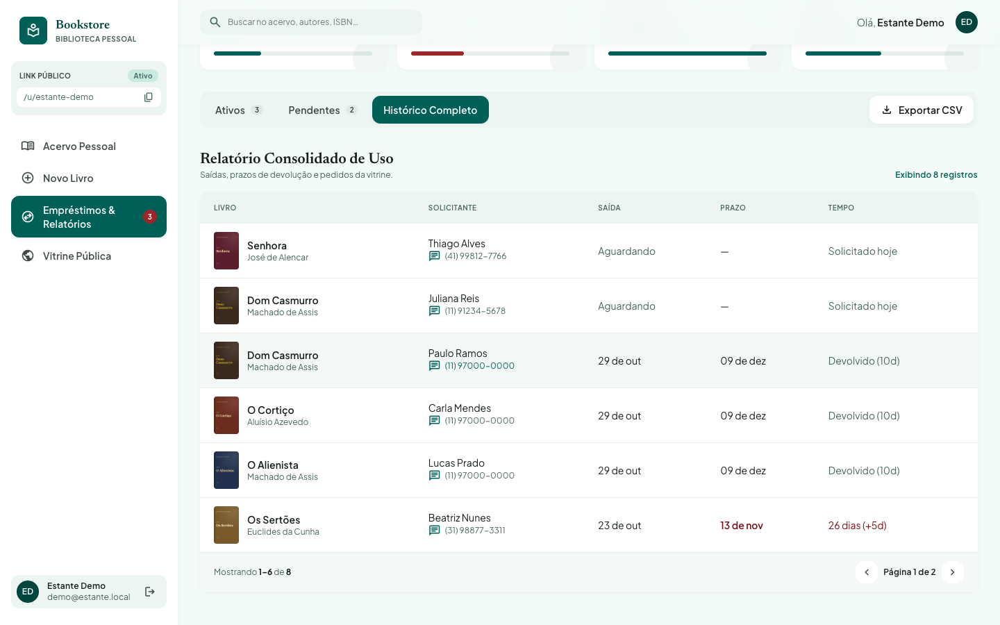 |

### 5. Vitrine pública

Em `/u/<slug>`, qualquer pessoa vê os livros públicos, filtra por gênero e pede um livro informando nome e WhatsApp. O visitante sabe se o livro está emprestado e quando deve voltar, mas **nunca vê quem pegou**. Pedidos repetidos do mesmo telefone para o mesmo livro são bloqueados. O link pode ser copiado ou compartilhado direto pelo painel.

| Vitrine | Pedido de empréstimo |
| --- | --- |
| 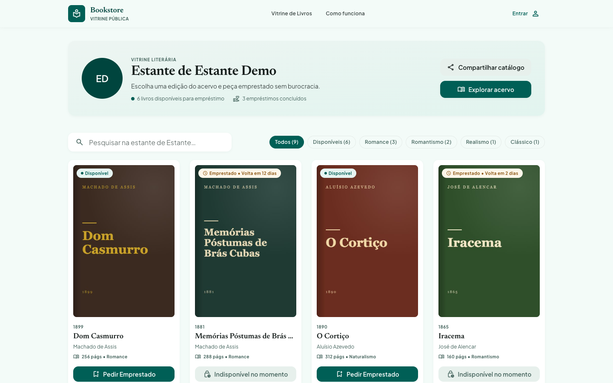 | 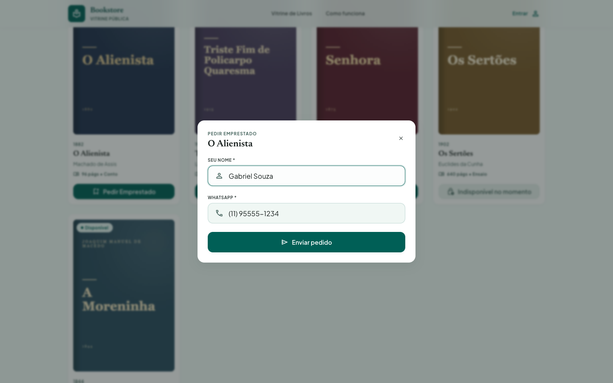 |

### 6. Mobile

O layout se adapta ao celular, com navegação inferior e botão central para adicionar livros.

<p align="center">
  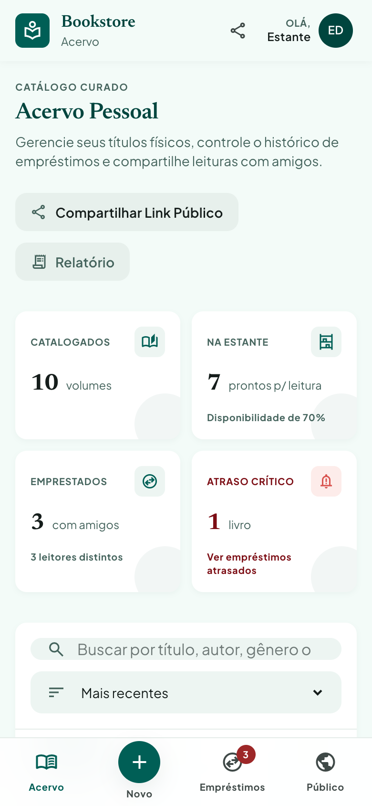
  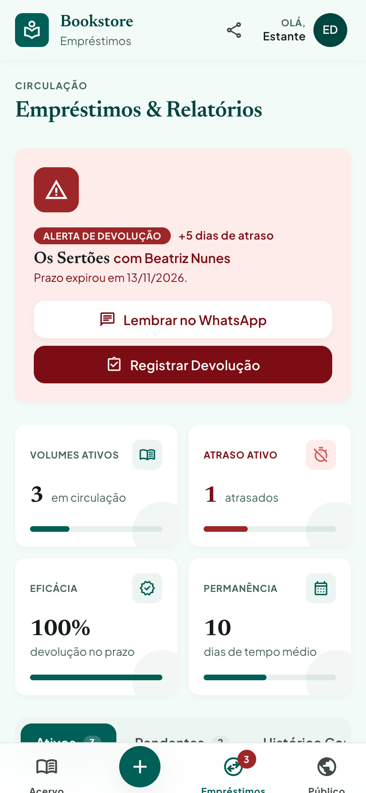
  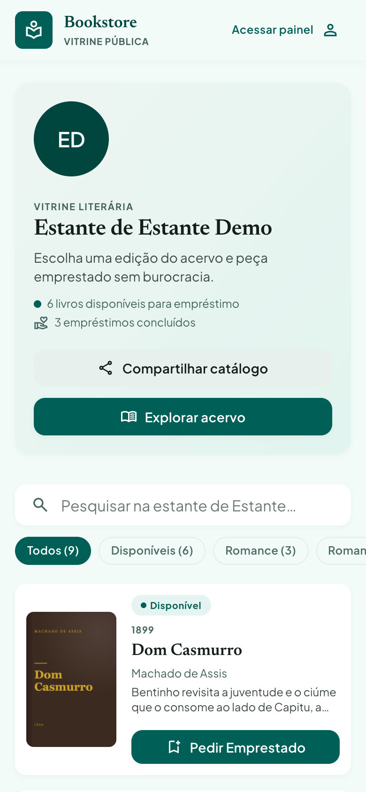
</p>

<h2 id="funcionalidades">Funcionalidades</h2>

- [x] Contas individuais com e-mail e senha
- [x] Login com Google (opcional)
- [x] Cadastro, edição e exclusão de livros, com capa, ISBN, editora, tags e sinopse
- [x] Busca, filtros, ordenação e visualização em grade ou lista
- [x] Empréstimos com prazo, alerta de atraso e cobrança pelo WhatsApp
- [x] Pedidos de empréstimo pela vitrine pública, com aprovação ou recusa
- [x] Registro de devolução e histórico completo
- [x] Relatório de uso com indicadores e exportação CSV
- [x] Vitrine pública por usuário (`/u/<slug>`), com controle de visibilidade por livro
- [x] Layout responsivo

<h2 id="como-executar">Como executar</h2>

### Com Docker (recomendado)

Requer Docker com Compose.

```bash
git clone https://github.com/frpbotero/EstanteLivros.git
cd EstanteLivros
cp .env.example .env   # defina JWT_SECRET; GOOGLE_CLIENT_ID é opcional
docker compose up -d --build
```

- Frontend: http://localhost:5173
- API: http://localhost:3333

O Compose sobe MongoDB 7, backend e frontend (servido pelo nginx). Crie uma conta na tela inicial para começar.

### Sem Docker

Requer Node.js 24 e um MongoDB acessível (local ou Atlas).

```bash
# Backend (porta 3000)
cd backend
npm install
cat > .env <<'EOF'
MONGODB_URI=mongodb://localhost:27017
DB_NAME=estante
JWT_SECRET=um-segredo-longo-e-aleatorio
FRONTEND_ORIGIN=http://localhost:5173
EOF
npm run dev

# Frontend (porta 5173), em outro terminal
cd frontend
npm install
npm run dev
```

Em desenvolvimento, o frontend usa `http://localhost:3000` como API quando `BACKEND_URL` não está definida.

### Variáveis de ambiente

| Onde | Variável | Obrigatória | Descrição |
| --- | --- | --- | --- |
| Backend | `MONGODB_URI` | sim | String de conexão do MongoDB |
| Backend | `DB_NAME` | sim | Nome do banco |
| Backend | `JWT_SECRET` | sim | Segredo para assinar os tokens (ex.: `openssl rand -hex 32`) |
| Backend | `FRONTEND_ORIGIN` | sim | Origens liberadas no CORS. Aceita lista separada por vírgula e curinga, ex.: `https://seu-site.vercel.app,https://seu-site-*.vercel.app` |
| Backend | `GOOGLE_CLIENT_ID` | não | Habilita o login com Google |
| Backend | `PORT` | não | Porta da API (padrão `3000`) |
| Frontend (build) | `BACKEND_URL` | sim no build | URL pública da API. O `vite build` falha sem ela |
| Frontend (build) | `GOOGLE_CLIENT_ID` | não | Mesmo client ID do backend |

Na Vercel, configure o projeto com *Root Directory* `frontend`. O `vercel.json` já redireciona todas as rotas para a SPA.

<h2 id="api">API</h2>

Rotas autenticadas exigem o cabeçalho `Authorization: Bearer <token>`.

| Método | Rota | Auth | Descrição |
| --- | --- | --- | --- |
| `POST` | `/auth/register` | | Cria conta e devolve o token |
| `POST` | `/auth/login` | | Login com e-mail e senha |
| `POST` | `/auth/google` | | Login com ID token do Google |
| `GET` | `/auth/me` | ✓ | Usuário da sessão |
| `GET` | `/livros` | ✓ | Lista os livros do usuário, com empréstimos e pedidos em aberto |
| `POST` | `/livros` | ✓ | Cadastra um livro |
| `GET` `PUT` `DELETE` | `/livros/:id` | ✓ | Consulta, edita ou exclui um livro |
| `GET` | `/reservas` | ✓ | Lista empréstimos e pedidos |
| `POST` | `/reservas` | ✓ | Registra um empréstimo |
| `PUT` | `/reservas/:id` | ✓ | Aprova um pedido (`pending` → `loan`), registra devolução (`loan` → `devolution`) ou ajusta o prazo |
| `DELETE` | `/reservas/:id` | ✓ | Remove um registro (usado para recusar pedidos) |
| `GET` | `/public/:slug` | | Livros públicos e estatísticas da vitrine |
| `POST` | `/public/:slug/reservas` | | Cria um pedido de empréstimo pela vitrine |
| `GET` | `/capa/:id` | | Imagem da capa, com cache longo |

<h2 id="tecnologias">Tecnologias</h2>

**Frontend:** React 18, React Router 6, Vite 4, Tailwind CSS 3, React Toastify, `@react-oauth/google`

**Backend:** Node.js 24, Express 4, MongoDB (driver oficial), JSON Web Token, bcryptjs, `google-auth-library`

**Infra:** Docker Compose (MongoDB 7, API e nginx), Vercel para o frontend

### Estrutura

```
EstanteLivros/
├── backend/            # API Express
│   ├── index.js
│   └── src/
│       ├── routes/     # auth, books, bookings, public
│       ├── auth.js     # JWT
│       ├── cors.js
│       ├── db.js       # conexão e índices
│       └── validate.js
├── frontend/           # SPA React + Vite
│   └── src/
│       ├── pages/      # Catalog, BookForm, Loans, PublicLibrary, Login
│       ├── components/
│       ├── data/       # contexto do acervo e ações de empréstimo
│       └── lib/        # datas, CSV, compartilhamento, imagens
├── design/             # referências de layout
├── docs/media/         # prints e vídeo deste README
└── docker-compose.yml
```

<h2 id="autor">Autor</h2>

Projeto feito por [Felipe Botero](https://github.com/frpbotero).

<h2 id="licenca">Licença</h2>

Este projeto está sob a licença MIT. Veja o arquivo [LICENSE](LICENSE) para mais detalhes.
